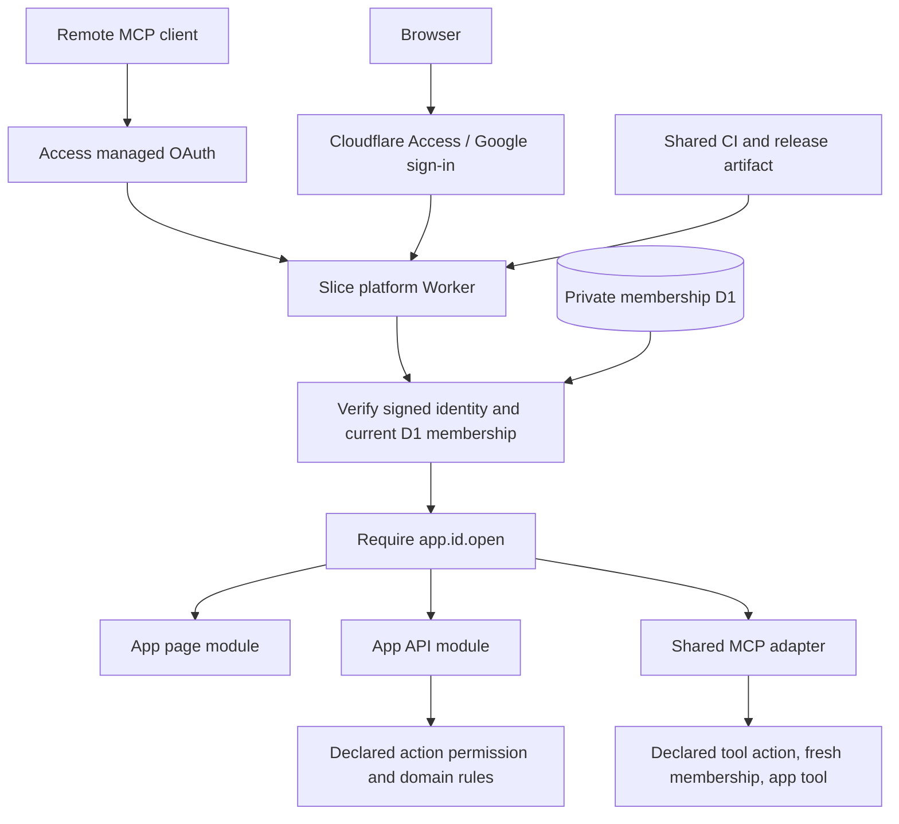

# Coding and architecture standards

## Boundaries

Apps are modules in `platform/apps/<id>`, bundled into one platform Worker. They inherit its Access session, permission enforcement, release artifact, credentials and rollback. Public metadata lives in `platform/apps/<id>/app.json`; a generated static server registry connects modules to guarded catch-all routes. Shared packages cannot import the host application. `scripts/check-architecture.mjs` parses TypeScript/JavaScript imports and re-exports, resolves aliases, checks workspace dependencies, and walks client import graphs. It rejects client paths reaching server-only modules, Cloudflare/Node server bindings, environment access, and nonliteral dynamic imports. Type-only contracts are allowed. Keep server modules marked with `server-only`; membership auth/API/repository are also recognized explicitly. This check supplements review and bundler isolation; it cannot prove arbitrary runtime code safe.

Common components and design tokens belong in `packages/ui`. Preserve Slice's approved logo, typography, colors, and accessible form conventions. App libraries belong in the host manifest; reusable libraries can become workspace packages. Avoid copy-pasting a design system into new apps.

## Server and data contracts

Validate external input at the boundary with explicit schemas and bounded payloads. Verify issuer, audience, signature, expiry, and human identity before resolving membership. Use the current database membership state on every protected request. A valid Syracuse identity alone is insufficient authorization. Never trust permissions from a client or stale session. Enforce same-origin writes and return private/no-store member responses. Parameterize database queries and atomically persist changes with audit history.

## Maintainability

Keep TypeScript strict; do not hide errors with blanket lint disables, any, unchecked casts, or catch-and-ignore. Explain unusual assumptions near the code. Keep modules focused by behavior. Tests should prove user-visible behavior or a security/reliability invariant, including rejection paths. A named test script is a minimum contract, not useful coverage by itself.

The host declares lint/typecheck/test/build commands and operational documentation for all modules. New app tests live beside their module and run in the host suite. `check:platform` verifies the catalog/registry and rejects per-app deployment configs, MCP SDK imports and server actions that bypass guarded dispatch. Module endpoints must use the platform page/API/tool contract; add action authorization and domain validation inside those handlers. Add shared checks to the reusable validation workflow to keep PR and release validation aligned.

## One platform request path

`/apps/<id>/...` and `/api/apps/<id>/...` are platform-owned routes. App pages are dynamic; APIs always return private/no-store. Mutations require same-origin JSON bounded to 16 KiB before app code runs. Unknown apps do not resolve to external URLs. There are no app-owned OAuth clients, Workers, deployment secrets or release jobs. A release and code rollback affect the whole platform; data migrations remain a separate operator responsibility.

Modules share a trusted runtime and origin. This architecture does not sandbox malicious code, isolate an XSS vulnerability between apps, or replace app-specific record-level authorization. Review module changes accordingly.

`/mcp` is the platform-owned remote client transport. It shares the signed identity verifier and current D1 permission model with pages/APIs, filters discovery and rechecks authorization before calls. Remote requests may omit Origin; any supplied Origin must match. Browser APIs retain their stricter same-origin mutation requirement. See [MCP](mcp.md) for the tool contract, transport limits and managed OAuth activation.
