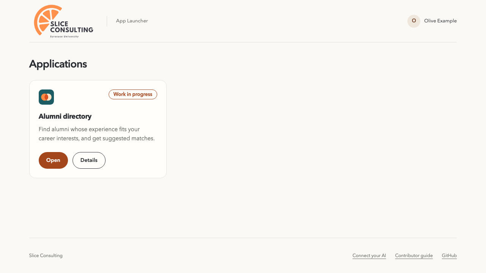
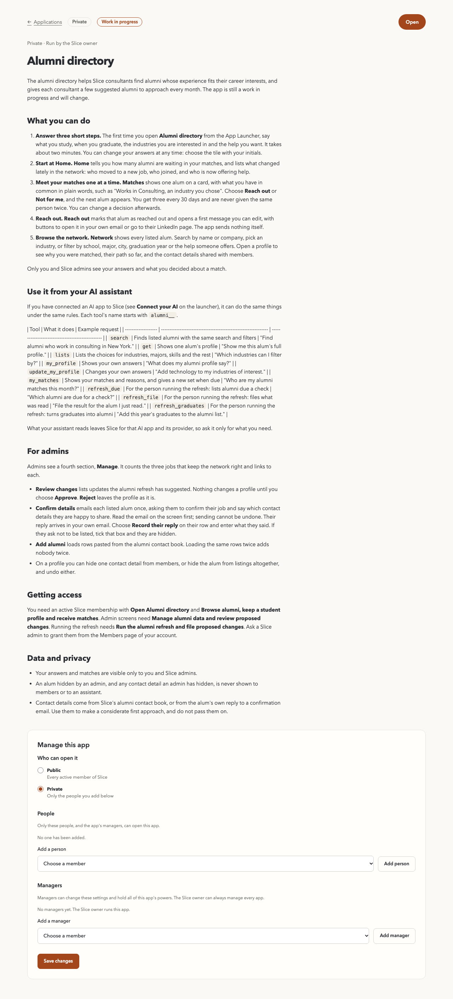
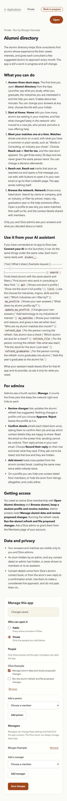
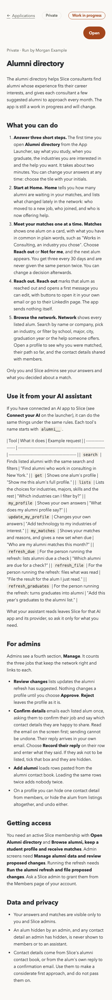

# App access screenshots

Captured from the synthetic browser test server (`pnpm test:e2e`, `platform/tests/e2e/settings.spec.ts`) with made-up people: an owner, Morgan Example and Olive Example. No real member data appears.

| View                                     | Screenshot                                               |
| ---------------------------------------- | -------------------------------------------------------- |
| A member's launcher, desktop (1280px)    |                  |
| The app page as its owner, desktop       |    |
| The app page with people added, mobile   |     |
| The app page as a member, mobile (390px) |  |

The settings are the **Manage this app** section at the bottom of the owner's page, below the guide.
