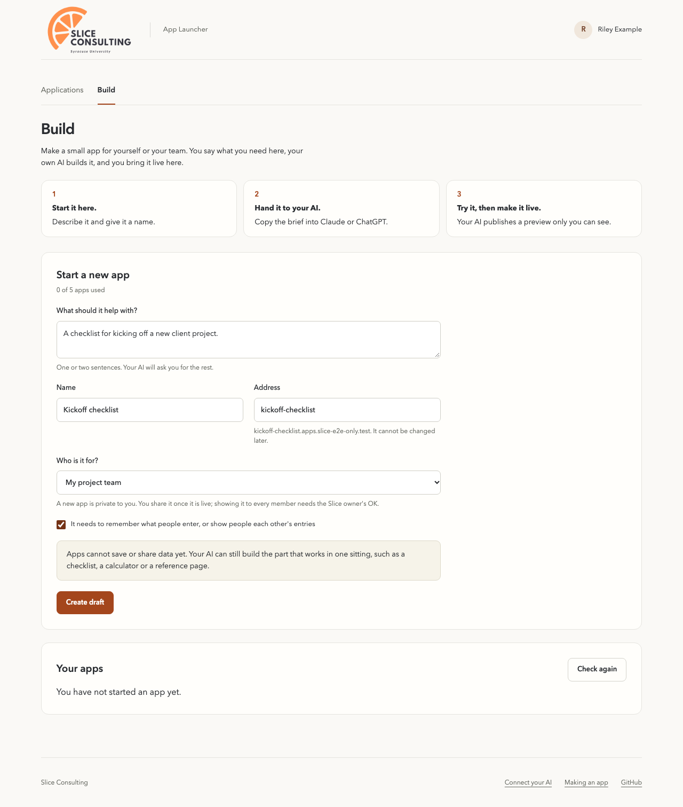
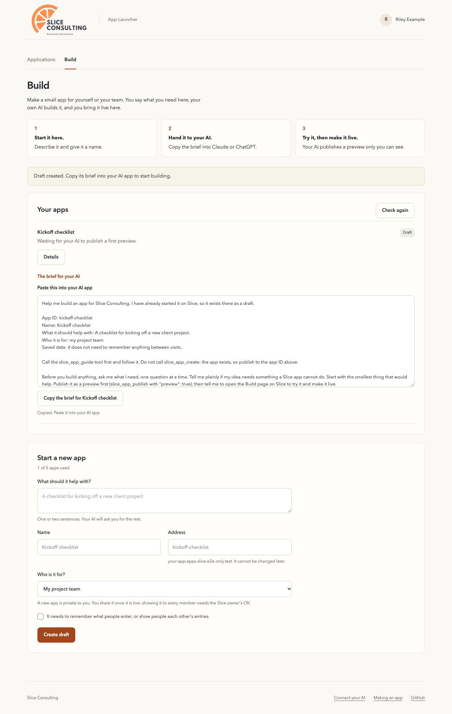
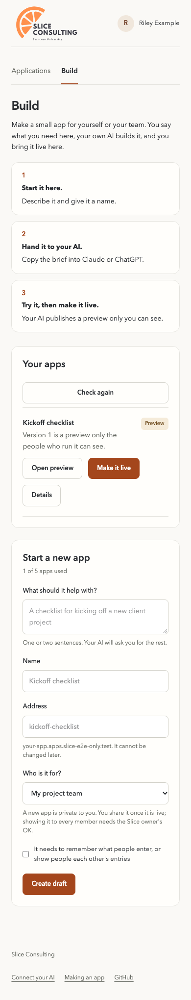

# Build page screenshots

Captured from the synthetic browser test server (`pnpm test:e2e`, `platform/tests/e2e/settings-member-apps.spec.ts`) with a made-up member, Riley Example. No real member data appears. The harness stands in for Riley's AI when a preview is published.

| View                                                   | Screenshot                                        |
| ------------------------------------------------------ | ------------------------------------------------- |
| Starting an app, with the saved-data notice, desktop   |        |
| A draft just created, with its brief, desktop (1280px) |  |
| A preview ready to make live, mobile (390px)           |       |

See [what a member does](../../member-apps.md#what-a-member-does).
