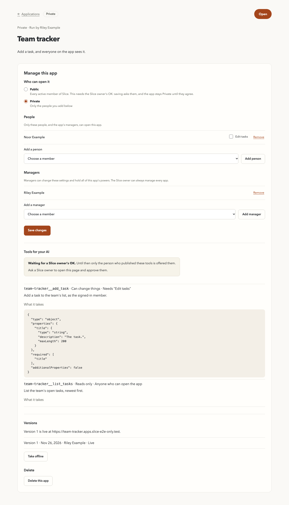
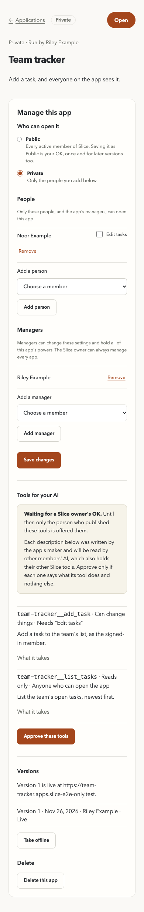
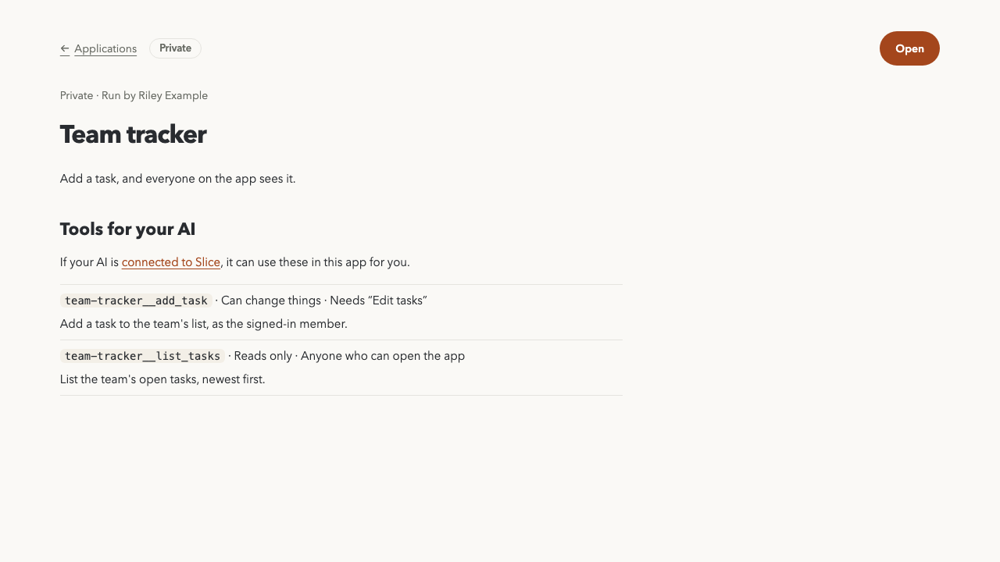

# Member-app tools screenshots

Captured from the synthetic browser test server (`pnpm test:e2e`, `platform/tests/e2e/settings-member-apps.spec.ts`) with made-up people: an owner, Riley Example (who made the app) and Noor Example (who it is shared with). No real member data appears, and no app's server code runs in that harness.

| View                                                         | Screenshot                                                          |
| ------------------------------------------------------------ | ------------------------------------------------------------------- |
| The app page as its manager, tools waiting, desktop (1280px) |  |
| The app page as an owner, about to approve, mobile (390px)   |       |
| The app page as someone it is shared with, after approval    |            |

See [tools for a member's AI](../../member-apps.md#tools-for-a-members-ai).
