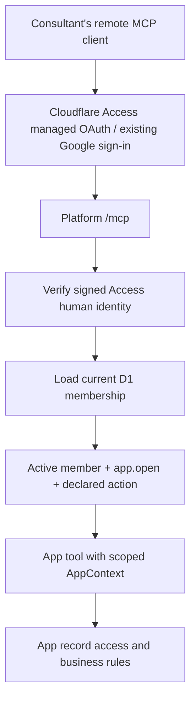

# Shared MCP access

Slice owns one remote MCP endpoint at `/mcp`. Consultants connect with an OAuth-capable Streamable HTTP client and sign in as themselves. App modules inherit identity, current membership, app/action permissions, transport and deployment. Apps register tools; they do not operate MCP servers or OAuth clients.

The checked-in catalog is empty, so the endpoint initially exposes only `slice_apps`, which returns the apps the current member may open. No membership administration or arbitrary API proxy is exposed. Code availability and production client access are separate: the operator must enable and verify managed OAuth as described below before advertising this endpoint to consultants.

## Identity and authorization



Cloudflare handles OAuth discovery, authorization-code flow with PKCE, tokens and refresh. The Worker verifies the resulting `Cf-Access-Jwt-Assertion` using the same issuer, audience, signature and human-identity checks as the browser/API. A client-supplied email, role or plain bearer token is not an application identity. CI service credentials are rejected by the application even if Access admits them at the perimeter.

Each protocol request loads current membership. Tool discovery includes only tools for which the active member has both `app.<id>.open` and the tool's declared action. A call reloads membership and checks both permissions again immediately before invoking app code. Pending, invited, suspended, unknown or rebound identities cannot use MCP. MCP does not enroll members: first visit the browser account page and complete the existing approval process. Revocation prevents subsequent dispatch; it cannot cancel a business operation already running.

The adapter creates a fresh server per request and stores no session identity or permission snapshot. Missing `Origin` is allowed for remote clients; when present it must match the platform origin. Cross-site browser requests are rejected. Browser app APIs retain their existing mandatory same-origin write check. No cross-origin browser CORS access is added.

## Register an app tool

First declare an action such as `records.read` in the app's catalog entry and run `pnpm apps:sync`. In `platform/apps/<id>/server.tsx`, add `tools` to the existing module:

```tsx
import { z } from "zod";
import type { AppModule } from "../../src/platform/contracts";
import { defineAppTool } from "../../src/platform/mcp-tool";
import { searchVisibleRecords } from "./records";

export default {
  Page: () => <p>Records</p>,
  tools: [
    defineAppTool({
      name: "search",
      description: "Search records visible to the current member",
      permission: "records.read",
      readOnly: true,
      inputSchema: z.object({ query: z.string().trim().min(1).max(80) }).strict(),
      async execute({ query }, context) {
        // Implement this app function with record-level access and bounded results.
        return { records: await searchVisibleRecords(context.member.id, query) };
      },
    }),
  ],
} satisfies AppModule;
```

`searchVisibleRecords` is an app implementation placeholder, not a platform API. Share business functions between page/API/tool handlers so record-level rules stay consistent. The platform automatically enforces the declared action; handlers must check any additional actions needed by conditional operations. `readOnly` supplies a client hint, not authorization or a guarantee that code cannot write. Mark writes accurately and require their own declared action. Client confirmation cannot grant a missing permission.

For an app named `alumni`, this tool is advertised as `alumni__search`. Tool names are lowercase letters/digits/underscores starting with a letter, up to 64 characters; the combined name is at most 128. Descriptions must be nonempty and at most 1,000 characters. Duplicate names, undeclared actions or more than 100 app tools fail closed. Keep schemas explicit and bounded. Tool output must be a JSON-serializable object with only data the current member may receive. Use pagination for larger results.

The transport accepts POST only, JSON responses, requests up to 16 KiB and serialized tool payloads up to 64 KiB. Protocol envelopes add overhead. It provides no persistent sessions, SSE subscriptions, resources, prompts or background tasks. Successful mutations must handle retries safely where duplicate execution would matter. Private responses are no-store and exceptions return generic messages. Add application audit history where required; the adapter does not automatically audit business operations.

CI rejects app imports of the MCP SDK and additional routes beneath `/mcp`. Use `defineAppTool` and the shared `AppContext`. Modules remain trusted code in one Worker, not sandboxes. Private tool results leave Slice for the selected MCP client/model provider; use only approved clients and disclose only necessary data. See [data boundaries](data-boundary.md).

## Activate remote sign-in

This is a production Access configuration change and needs maintainer authorization. It requires no new D1 schema, application credentials or app-specific login configuration.

1. Verify the merged Worker release and the existing self-hosted Access application protecting the whole platform hostname, including `/mcp`. Preserve its identity provider, audience, allowed domain, policies and CI service rule. Save its current configuration for rollback.
2. In Cloudflare Zero Trust, edit that application under **Access controls → Applications → Advanced settings → Managed OAuth**. Enable managed OAuth. Configure only the intended client redirect URIs; use exact HTTPS callbacks for hosted clients and the documented localhost/loopback callbacks for desktop clients. Do not allow arbitrary redirect destinations. If using the API, read the current application and preserve its complete configuration when setting `oauth_configuration.enabled=true`.
3. Without credentials, request `/mcp` and verify a Bearer challenge with same-origin protected-resource metadata and the intended Access authorization server. A normal HTML login redirect alone does not establish remote OAuth compatibility. Keep the application behind Access; do not add a bypass to make discovery work.
4. In an approved OAuth-capable MCP client, add the production origin followed by `/mcp` as a Streamable HTTP server. Complete the browser sign-in with the consultant's existing account. The client must support the OAuth resource indicator (RFC 8707). This setup is client-dependent; do not distribute a shared token or copy an Access cookie into client configuration.
5. With an active member, initialize, list tools and call `slice_apps`. Confirm tool visibility/calls match that member's app/action grants, then revoke a grant and verify subsequent calls fail. Test a suspended member and the CI service identity. Confirm ordinary browser login and release smoke still work. Record the tested client/version and release; synthetic tests do not establish this live OAuth evidence.

If activation fails, restore the saved Access configuration and disable managed OAuth while investigating. The Worker route can stay protected; code rollback follows the shared [release procedure](deployment.md). Coordinate access-policy rollback separately from Worker rollback. Do not loosen membership or token validation to accommodate an incompatible client.

Official references: [Cloudflare Access managed OAuth](https://developers.cloudflare.com/cloudflare-one/access-controls/applications/http-apps/managed-oauth/) and the [MCP TypeScript SDK](https://github.com/modelcontextprotocol/typescript-sdk). This implementation pins the SDK version in the launcher manifest and uses its Workers-compatible transport/validator.

## Validation

`src/platform/mcp.test.ts` exercises the real SDK client, signed synthetic identities and isolated D1 membership: filtered discovery, dispatch, revocation, cross-user isolation, service/forged identity rejection, bounded input/output and error handling. `mcp-worker.test.ts` separately bundles the adapter and performs signed discovery/calls in workerd, using a test-only identity key and state. Production build smoke checks that the compiled `/mcp` route rejects a synthetic service identity. None of these tests contacts production OAuth or uses real private data.

Run the full gate in [AGENTS.md](../AGENTS.md). App authors must add tests for their own schema, business rules, record ownership, restricted actions and denied/revoked access. The forward deployment check also requires the CI service identity to receive a private HTTP 401 from `/mcp`; rollback remains compatible with verified older releases that did not have this route.
