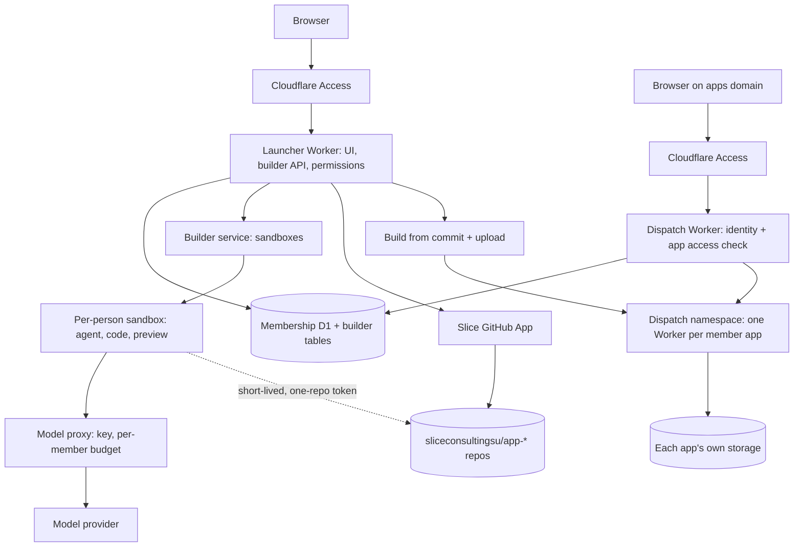

# In-app app builder

Status: **proposed design**, not approved for implementation. Written November 5, 2026.

## Why

Today only people who can use Git, GitHub, a terminal and the repository's review process can add an app to the launcher. Every app is a folder in this repository, reviewed by the maintainer and deployed with the whole platform. That keeps the platform safe, but it means most Slice consultants can use apps and never build one.

The goal is for **any Slice consultant** to build a small app for their team from inside the launcher by describing it to an agent, trying it and publishing it, without installing anything or learning GitHub. GitHub still keeps every app's code, history and backups, but the platform operates it on the consultant's behalf.

### What success looks like

- A consultant with no coding setup selects **Create app**, describes a lunch poll, tries it in the browser and publishes it to chosen colleagues within one sitting.
- Another consultant suggests an improvement, and the owner accepts it from the launcher.
- When the builder graduates, their app is handed to someone else instead of breaking quietly.
- A broken or malicious member app cannot read the launcher's membership data, other apps' data, or launcher sign-in cookies, and cannot take the launcher down.

## Goals

- Build from the launcher: create an app, then chat with an agent, see the code and try the app in one workspace.
- Choose who can use each app: **private** (named members) or **public** (all active Slice members).
- Keep every member app's code in its own private repository in the Slice Consulting GitHub organization (`sliceconsultingsu`), created and updated by the platform. Consultants never need a GitHub account.
- Publish without maintainer review, because each member app runs walled off from the platform and from other apps.
- Let members suggest changes to someone else's app; the owner or an editor accepts them.
- Support hand-over and handle abandoned apps.

## Non-goals

- Replacing the reviewed path for official apps. Apps such as the alumni directory stay in `platform/apps/<id>` in this repository, with review and the shared release.
- Giving member apps access to membership records, official app data or the launcher's MCP endpoint in the first release.
- A general hosting service for people outside Slice, custom domains per app, or paid tiers.
- A full code editor. Consultants mainly work through the agent; the code view is for reading, with light edits at most.
- Requiring consultants to use GitHub, a terminal or a local setup. A `slice push` command for technical members can come later.

## Anti-goals (would count as failure even if it works)

- Any member app able to read launcher cookies, the membership database, model or GitHub credentials, or another app's data.
- A consultant losing work because someone else published at the same time.
- Live code that differs from what GitHub holds. GitHub must always be able to explain what is running.
- Model or container spending without per-member limits.
- Weakening the reviewed path, protections or checks on `slice-launcher` to make the builder work.

## Decisions made by Ivan

These came out of the November 5, 2026 brainstorm.

1. Consultants build **in the browser**, in a workspace inside the launcher, not on their own laptops.
2. Apps are **private** (chosen members) or **public** (all active members).
3. **GitHub stays, hidden.** The platform's GitHub App creates and updates one private repository per member app. Consultants never see GitHub unless they want to.
4. Those repositories live in the **Slice Consulting GitHub organization**, `sliceconsultingsu`, not a personal account.
5. Others improve an app through **suggest a change → owner accepts**. Ownership can be handed over.
6. Each member app runs **walled off** in its own Worker, not inside the launcher Worker.

Earlier in the brainstorm, Ivan named the Codex harness (`codex app-server`) as a candidate agent.

## How consultants use it

### Create

1. On the launcher, an active member with the builder permission selects **Create app**.
2. They enter a name, pick a starting template (for example form, list, poll or simple dashboard) and choose **Private** or **Public**. For Private, they pick members.
3. The platform creates `sliceconsultingsu/app-<slug>` from the template, records the app in D1 with the creator as owner, and opens the workspace.

### Workspace

The workspace has three panes: **chat** with the agent, **code** (file tree and read view), and **preview** (the app running live, as the consultant would see it).

- Each person editing an app gets their own sandbox and their own working branch, so two people never overwrite each other.
- The agent can read and change files, add npm packages, run the app and its tests, and explain what it did. Packages are bundled into the app at build time; because the app runs walled off, package choice is not reviewed.
- Work is saved to the person's branch in GitHub regularly, so closing the tab loses nothing.

### Publish

- An **owner or editor** selects **Publish**. The platform builds the app from the saved commit, deploys it and updates the launcher card. The previous version stays available for **Undo**.
- Anyone else who can open the app sees **Suggest change** instead. Their branch becomes a pull request behind the scenes. The owner sees "Ben suggested a change", with a preview and a summary of what changed, and selects **Accept** or **Decline**.
- If the published version moved on while someone was working, the workspace brings their branch up to date first. The agent resolves simple conflicts and asks the person about anything else.

### Share, hand over, retire

- The owner can switch Private/Public, add or remove members, and add editors.
- The owner can hand the app to another active member, who must accept. An administrator can reassign an app whose owner left.
- The owner can **archive** an app: it disappears from the launcher and stops serving, while its repository and data are kept so an administrator can restore it. Permanent deletion is an administrator action.
- Each member can own up to 5 active apps by default, which administrators can raise.
- An app whose owner is no longer an active member is flagged to administrators; after 30 days without a new owner it is hidden from the launcher (not deleted). The repository is kept.

## Architecture

### Where each thing lives

| Thing                                                             | Where                                                         | Why                                                        |
| ----------------------------------------------------------------- | ------------------------------------------------------------- | ---------------------------------------------------------- |
| App records, owners, editors, access lists, versions, suggestions | New tables in the private membership D1                       | Same permission source as the rest of the platform         |
| Source code and history                                           | Private repo per app in `sliceconsultingsu`                   | Free history, undo, backup, pull requests and an easy exit |
| Work in progress                                                  | Sandbox, saved to the person's branch                         | Survives the sandbox going to sleep                        |
| Built version of each published commit                            | R2, keyed by app and commit                                   | Fast undo without rebuilding                               |
| Running app                                                       | Its own Worker in a Workers for Platforms dispatch namespace  | Walled off from the launcher and other apps                |
| The app's own data                                                | Storage created for that app only (D1 per app is the default) | An app can only reach its own data                         |

### GitHub behind the scenes

- **One GitHub App**, owned by `sliceconsultingsu`, with only the repository permissions it needs: contents, pull requests, metadata and the administration permission needed to create repositories. Its ID and private key are Cloudflare secrets of the launcher. No consultant, sandbox or member app ever sees the private key.
- **Short-lived, narrow tokens.** For each operation the launcher mints an installation token limited to the one repository and the permissions that operation needs (`repository_ids` and `permissions` when creating the token). A sandbox receives a token for its own app's repository only, with contents write and no administration.
- **Repository creation** is the only operation that uses administration permission, and it runs only in the launcher, never in a sandbox.
- **Naming and visibility.** Repositories are `app-<slug>`, always private, created from a template repository (`member-app-template`). The template contains no secrets or data.
- **Branches.** `main` is what is live. Each workspace uses `ws/<member-id>/<n>`. Publish by an owner or editor merges the branch into `main` through a pull request the bot opens and merges immediately, so every publish appears in history. A suggestion leaves the pull request open until the owner accepts.
- **Commit identity.** Commits are made by the bot, with the consultant's display name in the commit message, for example "Ana Lopez via Slice". Consultants' email addresses are not written into Git history.
- **Access is decided by Slice, not GitHub.** GitHub collaborators are not used. The org's human members stay limited to administrators, who can always open GitHub directly. That is the recovery path if the builder is down.

**Risk specific to using `sliceconsultingsu`:** the same organization holds the public `slice-launcher` repository. If GitHub requires the App to be installed on all repositories in order to create new ones, the App could in principle write to `slice-launcher`. Phase 0 must establish the narrowest installation that still allows repository creation (preferably selected repositories, with new repositories added automatically or by the App). If an all-repository installation is unavoidable:

- `slice-launcher` keeps its branch protection and ruleset, with the App outside every bypass list;
- deletion and force pushes stay blocked;
- tokens are always minted for one repository at a time.

### Workspace sandbox

- One sandbox (a Cloudflare Sandbox container) per person per app, started when the workspace opens and put to sleep after inactivity. Containers need a Durable Object-backed Worker. Hosting them in a separate **builder service** Worker that the launcher calls through a service binding keeps the launcher's bundle and permissions unchanged (builder's choice; this is the expected shape).
- **Agent harness:** run `codex app-server` inside the sandbox and drive it over JSON-RPC (`thread/start`, `turn/start`), streaming its messages to the chat pane. The builder may swap harnesses behind the same chat interface if Codex proves unsuitable in Phase 0.
- **No long-lived secrets in the sandbox.** The agent and the app's own code run in the same container, so anything in it must be assumed readable by app code. Model calls go through a platform **model proxy** that holds the API key, checks a short-lived workspace token and enforces per-member budgets. The sandbox's GitHub token covers one repository and expires within an hour.
- **Network.** Sandboxes can reach the model proxy, GitHub and the package registry. Anything else is blocked unless the template needs it.
- **Preview** is served from the sandbox on the apps domain (see below), never on the launcher's origin, and requires the same sign-in.

### Build and deploy

- Publish builds in a **fresh build sandbox from the commit on `main`**, not from the workspace's current files. That way what runs always matches GitHub.
- The build produces a Worker bundle. The launcher uploads it to the dispatch namespace as script `app-<slug>` through the Cloudflare API, with **bindings chosen by the platform** (the app's own storage and the Slice context only). App code cannot request bindings.
- The bundle is stored in R2. **Undo** re-uploads a previous bundle and records a new version row; it does not rewrite Git history. Undo restores code only, not the app's data. Templates should make data changes additive so an older version still works with newer data.
- Deploys use a Cloudflare API token limited to the dispatch namespace, R2 and per-app storage. The existing CI deploy token is not reused.

### Running an app

- Member apps are served from a **separate apps domain**, ideally one subdomain per app (`<slug>.apps.<domain>`), so apps cannot read the launcher's cookies or each other's. This needs a custom domain on Cloudflare; `workers.dev` alone cannot give each app its own origin.
- The apps domain sits behind its own Cloudflare Access application (same identity provider, separate audience).
- A platform-owned **dispatch Worker** handles every request:
  1. verifies the Access JWT the same way the launcher does;
  2. loads current membership and the app's access list from D1;
  3. rejects people who may not open the app;
  4. strips any incoming `X-Slice-*` headers;
  5. calls `env.DISPATCHER.get("app-<slug>", {}, { limits })` with CPU and subrequest limits, adding the member's opaque ID and display name as `X-Slice-*` headers.
- Member app Workers are reachable only through the dispatch Worker, so they can trust those headers. They receive no email address in the first release.
- **Outbound requests** from member apps go through a Workers for Platforms outbound Worker. The first release blocks all outbound requests. There is no Slice API for member apps yet beyond the identity headers. An allowlist or a narrow Slice API can come later with review.

### Builder permissions

- A new platform permission, `builder.create`, lets a member create apps. To meet the "all consultants" goal it is granted to the default Member level, and administrators can revoke it per person like any other permission.
- Per-app roles live in D1:
  - **owner**: one per app; shares, publishes, accepts suggestions and hands over;
  - **editor**: publishes and accepts suggestions;
  - **user**: opens the app.
- The launcher lists member apps the person can open alongside official apps, with a **Member-made** label and the owner's name, plus a **My apps** view for apps they own or edit.
- Public apps treat every active member as a user. Pending and suspended members cannot open, view or build anything.
- Anyone who can open an app can view its code and suggest changes. Only owners and editors publish.

### Data model (new D1 tables, sketch)

- `member_apps`:
  - identity: id, slug, name, description;
  - ownership and status: owner member id, visibility, status (active, hidden, archived);
  - links: GitHub repository id and name, live version id;
  - created and updated timestamps.
- `member_app_roles`: app id, member id, role (editor or user).
- `member_app_versions`: id, app id, commit SHA, R2 bundle key, published by, published at, status.
- `member_app_suggestions`: id, app id, author member id, branch, pull request number, status.
- `member_app_workspaces`: id, app id, member id, branch, sandbox id, last active.
- Changes to ownership, visibility, roles and publishing write audit records, like membership changes do today.

## Platform rules this changes

`AGENTS.md` and `docs/architecture.md` currently say "one platform, one login, one permission system, one deployment" and forbid app-specific Workers and deployment jobs. Member apps deliberately break that rule. The implementation must update those documents in a reviewed PR so they describe two tiers:

- **Official apps:** trusted modules in this repository, reviewed and deployed with the platform. Today's rules apply unchanged.
- **Member apps:**
  - untrusted code in their own repositories and their own Workers;
  - reached only through the dispatch Worker;
  - no access to platform data;
  - never imported into the launcher bundle.

The single login and single permission system still hold for both tiers. The builder service, dispatch Worker and model proxy are platform components, owned by this repository and released through the existing workflow.

## Costs to check before committing

From memory, so each must be verified during Phase 0:

- **Workers for Platforms:** a paid add-on, roughly $25 per month at last check.
- **Sandboxes (containers):** billed for the time they are awake, so idle timeouts matter.
- **Model usage:** the largest variable cost. It needs a per-member daily or monthly budget, a Slice-wide cap and a usage view for administrators.
- **GitHub:** the free organization plan allows unlimited private repositories. The design avoids GitHub Actions minutes by building in the sandbox.
- **Per-app D1 databases:** count against account limits.

## Rollout

Each phase gets its own implementation plan and PRs, and is usable or testable before the next starts.

Production configuration changes (the GitHub App, the apps domain and its Access application, the dispatch namespace, API tokens and secrets) and D1 migrations need maintainer authorization at the time they are made, as `AGENTS.md` requires. Approving this design does not authorize them.

0. **Prove the risky parts (spike, throwaway).**
   - The GitHub App can create and update repositories in `sliceconsultingsu`, with the narrowest installation.
   - Workers for Platforms is enabled.
   - A member Worker deployed through the API is reachable only through a dispatch Worker.
   - `codex app-server` runs in a Cloudflare Sandbox and uses the model proxy without holding the real key.
   - The apps domain and its Access application are in place.
   - Costs are confirmed.
1. **Publish without the agent.** Administrators only, behind a flag:
   - create an app from a template;
   - edit it as an administrator through GitHub;
   - publish, open it through the dispatch Worker with private/public access, and undo.
2. **Workspace.** Sandbox, code view, preview, agent chat, saving to a branch, and Publish by the owner.
3. **Collaboration.** Editors, suggest and accept, hand-over, abandoned-app handling and audit views.
4. **Open to all consultants.** Grant `builder.create` to the Member level, turn on budgets and usage views, and publish consultant-facing docs.

## Testing expectations

- **Denial paths:** pending, suspended and removed members; private apps opened by non-listed members; revoked builder permission; non-owners publishing or accepting.
- **Header handling:** forged `X-Slice-*` headers are stripped.
- **Isolation:**
  - a member app cannot reach the membership D1, another app's storage, the launcher origin's cookies, or arbitrary internet hosts;
  - a sandbox token cannot touch another repository.
- **Consistency:**
  - the live version always equals a commit on `main`;
  - concurrent publishes resolve without lost work.
- **Budgets:** an exhausted budget stops the agent with a clear message.
- **Fixtures:** synthetic members and apps only; no real member data in fixtures, repos or logs.

## Left to the builder

- Exact template set and template structure. Templates must build to a single Worker and use only platform-provided bindings.
- Workspace layout and visual design, following the [design profile](../../design-profile.md).
- Sandbox idle timeout, CPU and subrequest limits, and budget numbers. Defaults should be conservative, with the reasoning written next to the setting.
- Whether the builder service is one Worker or split further.
- How agent messages are streamed to the browser.

## Calls made in this document, not by Ivan

Ivan should check these while reading:

- **Templates first:** apps start from Slice templates in the first releases.
- **Per-app storage:** each app gets its own storage, defaulting to a D1 database per app; member apps get no access to platform data in the first release.
- **Code visibility:** anyone who can open an app can see its code and suggest changes; only owners and editors publish.
- **Who can build:** `builder.create` is granted to all Members by default, revocable per person.
- **Abandoned apps:** an app whose owner left is hidden after 30 days without a new owner, never deleted automatically.
- **Builds:** builds run in a fresh sandbox from the `main` commit; GitHub Actions is not used.
- **Outbound traffic:** member apps can reach no outside hosts in the first release.
- **Agent harness:** Codex `app-server` is the starting choice, replaceable behind the chat interface.
- **Commit identity:** commits use the bot identity plus the consultant's display name, never their email.
- **Packages:** any npm package is allowed in member apps, since they run walled off.
- **App limit:** each member can own up to 5 active apps by default.
- **Archive, not delete:** owners archive; only administrators delete permanently.

## Open questions for Ivan

These change what gets built. Answers will be folded in before approval.

1. **Apps domain.** Giving each member app its own address needs a custom domain on Cloudflare, such as one Slice owns. Without one, all member apps share a single address and can read each other's cookies and storage, which weakens the main safety promise. Is there a domain, or should one be bought?
2. **Model costs.** Whose model account pays for the agent, and roughly what monthly cap is acceptable for the whole club and per consultant?
3. **GitHub fallback.** If GitHub only lets the App create repositories when it is installed on every repository in `sliceconsultingsu`, should the builder accept that (with the protections above on `slice-launcher`), or move member apps to a second organization that Slice also owns?
