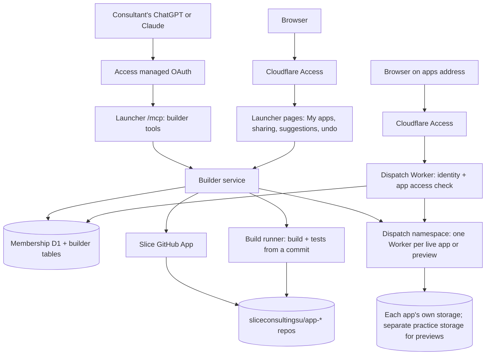

# Member app builder

Status: **proposed design**, not approved for implementation. Written November 5, 2026.

## Why

Today only people who can use Git, GitHub, a terminal and the repository's review process can add an app to the launcher. Every app is a folder in this repository, reviewed by the maintainer and deployed with the whole platform. That keeps the platform safe, but most Slice consultants can use apps and never build one.

The goal is for **any Slice consultant** to build and improve small apps for their team **from the AI app they already use**, ChatGPT or Claude. They describe what they want, try it and publish it. They never install a coding setup or learn GitHub.

The consultant's AI connects to the Slice site through Slice's MCP connector. The site gives the AI building tools and does all the work with GitHub behind the scenes. The AI never talks to GitHub.

### What success looks like

- A consultant with no coding setup asks their ChatGPT or Claude to "make a lunch poll for my team". They try the preview link it gives them and publish it to chosen colleagues in one sitting.
- Months later, a different consultant asks their own AI to "add a voting deadline to the lunch poll". The AI understands the app without help, and the owner accepts the suggestion from the launcher.
- When the builder graduates, their app is handed to someone else instead of breaking quietly.
- A broken or malicious member app cannot read the launcher's membership data, other apps' data or launcher sign-in cookies, and cannot take the launcher down.

## Goals

- Build and change apps entirely through the consultant's own AI, using Slice's MCP tools.
- Make changing an existing app as easy for a newcomer's AI as building a new one.
- Choose who can use each app: **private** (named members) or **public** (all active Slice members).
- Keep every member app's code in its own private repository in the Slice Consulting GitHub organization (`sliceconsultingsu`). The Slice site creates and updates it, so consultants never need a GitHub account.
- Publish without maintainer review, because each member app runs walled off from the platform and from other apps.
- Let members suggest changes to someone else's app; the owner or an editor accepts them.
- Support hand-over and handle abandoned apps.

## Non-goals

- An AI, chat window or code editor inside the launcher. Building happens in the consultant's own AI app.
- Slice paying for AI models. Consultants use their own ChatGPT or Claude accounts.
- Replacing the reviewed path for official apps. Apps such as the alumni directory stay in `platform/apps/<id>` in this repository, with review and the shared release.
- Giving member apps access to membership records, official app data or the launcher's own MCP tools in the first release.
- Direct Git access or a `slice push` command for technical consultants. That can come later.
- A general hosting service for people outside Slice, custom domains per app, or paid tiers.

## Anti-goals (would count as failure even if it works)

- Any member app able to read launcher cookies, the membership database, the GitHub App key or another app's data.
- A consultant's AI receiving GitHub credentials or access to a repository the person may not see.
- A consultant losing work because someone else published at the same time.
- Live code that differs from what GitHub holds. GitHub must always be able to explain what is running.
- Building tools sending real member data from an app to a consultant's AI provider. Tools return code, build results and errors, not app records.
- Weakening the reviewed path, protections or checks on `slice-launcher` to make the builder work.

## Decisions made by Ivan

These came out of the November 5, 2026 brainstorm.

1. **Consultants work in their own AI app** (ChatGPT or Claude), connected to the Slice site through MCP. There is no workspace or Slice-run AI in the launcher.
2. **The AI talks only to the Slice site.** The site checks permissions and reads and saves code in GitHub on the AI's behalf.
3. **GitHub stays, hidden.** One private repository per member app, in the Slice Consulting organization `sliceconsultingsu`.
4. **Changes are drafts first.** An AI's edits go into the consultant's draft. They go live only when an owner or editor publishes, or when the owner accepts a suggestion.
5. **There must be an easy workflow for an AI to change an app or add features**, not only to create one.
6. Apps are **private** (chosen members) or **public** (all active members).
7. Others improve an app through **suggest a change → owner accepts**. Ownership can be handed over.
8. Each member app runs **walled off** in its own Worker, not inside the launcher Worker.
9. **The Cloudflare placeholder address** (`workers.dev`) is used for now, not a custom domain.

## How consultants use it

### Connect once

The consultant adds the Slice connector in ChatGPT or Claude and signs in with their Slice account, as described in [Connect your AI](../../connect-your-ai.md). After that, their AI sees the Slice building tools and the instructions that come with them.

### Build a new app

1. The consultant asks: "Make a lunch poll for my team."
2. The AI calls **create app** with a name and a Slice template, for example form, list, poll or simple dashboard. The site creates `sliceconsultingsu/app-<slug>` from the template and records the consultant as owner. The app starts **private to its owner**.
3. The AI writes the code in a draft, checks it, and returns a **preview link** that uses practice data.
4. The consultant tries the preview in their browser and asks for changes. The AI repeats the edit, check and preview steps.
5. "Publish it." The AI calls **publish**, and the app goes live. In the launcher, the owner chooses Private (with named members) or Public.

### Change an existing app

Example: Ben asks Claude to "add a voting deadline to the lunch poll".

1. **Find it.** The AI calls **list apps**: "Lunch poll, owned by Ana. You can suggest changes."
2. **Understand it.** The AI calls **get app** and receives:
   - the app's **guide** (below);
   - a file map;
   - the live version and recent changes;
   - Ben's role and any drafts he already has.
3. **Start a draft.** The AI calls **start draft** with the goal "voting deadline". Ben's draft is separate from the live app and from anyone else's draft.
4. **Edit.** The AI reads and searches files, then makes small edits ("replace this with that") or writes new files. Each edit is saved to Ben's draft in GitHub.
5. **Check.** The site builds the draft and runs its tests, returning problems with file and line numbers. The AI fixes them and checks again.
6. **Try.** The AI calls **preview** and gives Ben a link to his version, running on practice data.
7. **Finish.** Owners and editors **publish**. Anyone else **suggests**: Ana sees "Ben suggested a voting deadline" in the launcher, with a summary and a preview link, and selects **Accept** or **Decline**.

### What makes changes easy for an AI

- **Every app carries its own guide.** Each repository has an `APP.md` describing:
  - what the app does and who uses it;
  - how its files are organized and the template's rules;
  - how data is stored;
  - a short log of features.

  The template supplies the first version. The tool instructions tell the AI to update it as part of every change. This is how a new consultant's AI, months later, starts with full context.

- **Small edits.** Edit tools change exact pieces of a file instead of rewriting whole files. That's faster, uses less of the AI's context and is less likely to break unrelated parts.
- **Drafts.** Nothing goes live until publish or accept. Several people can each have a draft of the same app.
- **Check before live.** Publish refuses unless the check passed on the draft's latest saved state. Templates ship with basic tests, and tool instructions ask the AI to add tests for new features.
- **Practice data in previews.** Each preview has its own storage, filled from the template's sample data. Trying a change can't alter real records.
- **Fixing problems is part of the loop.** Owners' and editors' AIs can read recent errors from the live app and list or undo published versions.
- **Instructions travel with the tools.** Each tool's description says when to use it and what comes next, so consultants only need to say what they want.
- **Staying current.** If the live app changed after a draft started, check reports it and **update draft** brings in the newer version. Conflicting files come back marked so the AI can resolve them, and it asks the consultant when the right answer is unclear.

### Manage in the launcher

The launcher is where people look at, share and manage apps:

- **Listing:** member apps the person can open appear alongside official apps, with a **Member-made** label and the owner's name. A **My apps** view lists apps they own or edit.
- **App page** (sharing changes happen only here, not through the AI):
  - live link, open drafts with preview links, and pending suggestions (Accept or Decline);
  - Private/Public and member list, editors;
  - versions with **Undo**;
  - **Hand over** and **Archive**.
- **Hand-over:** the owner hands the app to another active member, who must accept. An administrator can reassign an app whose owner left.
- **Archive:** archiving hides the app and stops it serving, but keeps its repository and data. Permanent deletion is an administrator action.
- **Abandoned apps:** an app whose owner is no longer an active member is flagged to administrators. After 30 days without a new owner it is hidden (not deleted).
- **Limits:** each member can own up to 5 active apps by default, which administrators can raise.

## Architecture

### Where each thing lives

| Thing                                                                     | Where                                                                                                  | Why                                                                |
| ------------------------------------------------------------------------- | ------------------------------------------------------------------------------------------------------ | ------------------------------------------------------------------ |
| App records, owners, editors, access lists, drafts, versions, suggestions | New tables in the private membership D1                                                                | Same permission source as the rest of the platform                 |
| Source code, drafts and history                                           | Private repo per app in `sliceconsultingsu`, one branch per draft                                      | Free history, undo, backup, pull requests and an easy exit         |
| Built version of each published commit                                    | R2, keyed by app and commit                                                                            | Fast undo without rebuilding                                       |
| Running app and previews                                                  | Their own Workers in a Workers for Platforms dispatch namespace                                        | Walled off from the launcher and each other's code                 |
| The app's own data                                                        | Storage created for that app only (D1 per app by default), plus separate practice storage for previews | An app can only reach its own data; previews can't touch real data |

### Builder tools (MCP)

The tools are registered by the platform host, not by an app module. They are a reviewed extension of the existing `/mcp` adapter, using the same signed identity, current membership and per-call permission checks. Every builder tool also requires `builder.create`, and every call is checked against the person's current role on that app.

| Tool                                                             | Who                              | What it does                                                                                                |
| ---------------------------------------------------------------- | -------------------------------- | ----------------------------------------------------------------------------------------------------------- |
| `builder_list_apps`                                              | Members with `builder.create`    | Apps the person owns, edits or can suggest to, with their role                                              |
| `builder_create_app`                                             | `builder.create`                 | Creates the repository from a template and records the owner                                                |
| `builder_get_app`                                                | Anyone who can open the app      | Guide, file map, live version, recent changes, the caller's role and drafts                                 |
| `builder_start_draft`                                            | Anyone who can open the app      | Creates the caller's draft branch for a stated goal                                                         |
| `builder_read_files`, `builder_search`                           | Anyone who can open the app      | Reads or searches files in the live version or the caller's own draft                                       |
| `builder_edit_file`, `builder_write_file`, `builder_delete_file` | Draft owner                      | Exact replacements, whole-file writes and deletions in the caller's draft; several edits can go in one call |
| `builder_update_draft`                                           | Draft owner                      | Brings newer live changes into the draft and reports conflicts                                              |
| `builder_check`                                                  | Draft owner                      | Builds the draft's latest commit and runs its tests; returns errors with file and line                      |
| `builder_preview`                                                | Draft owner                      | Deploys the draft with practice storage and returns a link                                                  |
| `builder_publish`                                                | Owner or editor                  | Requires a passing check on the latest commit; merges the draft and deploys it live                         |
| `builder_suggest`                                                | Anyone else who can open the app | Opens a suggestion with a summary for the owner                                                             |
| `builder_accept_suggestion`, `builder_decline_suggestion`        | Owner or editor                  | Same as the launcher buttons                                                                                |
| `builder_logs`                                                   | Owner or editor                  | Recent errors from the live app or a preview                                                                |
| `builder_versions`, `builder_undo`                               | Owner or editor                  | Lists published versions and restores one                                                                   |

Constraints:

- **Request size.** The current `/mcp` transport accepts requests up to 16 KiB and tool payloads up to 64 KiB. Builder tools need a larger, still bounded, limit for file writes, or chunked writes. Either way it is a reviewed transport change. Edits are the normal path; whole-file writes are for new files.
- **Retries.** Mutating tools must be safe to retry. For example, an edit whose exact text is already replaced reports success instead of applying twice.
- **Rate limits.** Per-member limits on edits, checks and previews, because builds use paid container time.
- **What goes to the AI provider.** Tool results go to the consultant's AI provider, OpenAI or Anthropic. They contain code, build output and errors only, never app records. Logs return error messages, stack traces and request paths without query strings or bodies, and the template is written not to log personal data.
- **Prerequisite.** Managed OAuth for `/mcp` is not yet active in production (see [MCP](../../mcp.md)). It must be enabled and verified first.

### GitHub behind the scenes

- **One GitHub App**, owned by `sliceconsultingsu`, with only the repository permissions it needs: contents, pull requests, metadata and the administration permission needed to create repositories. Its ID and private key are Cloudflare secrets of the builder service. No consultant, AI, build runner or member app ever sees them.
- **Short-lived, narrow tokens.** For each operation the builder mints an installation token limited to the one repository and the permissions that operation needs (`repository_ids` and `permissions` when creating the token). Tokens stay inside the builder service; the AI only ever sees tool results.
- **Repository creation** is the only operation that uses administration permission.
- **Naming and visibility.** Repositories are `app-<slug>`, always private, created from a template repository (`member-app-template`). The template contains no secrets or data.
- **Branches.**
  - `main` is what is live.
  - Each draft is `draft/<member-id>/<n>`, and each edit tool call is a commit on it.
  - Publishing squash-merges the draft into `main` through a pull request the bot opens and merges, so each change is one commit in history.
  - A suggestion leaves the pull request open until the owner accepts.
- **Commit identity.** Commits are made by the bot, with the consultant's display name in the commit message, for example "Ana Lopez via Slice". Consultants' email addresses are not written into Git history.
- **Access is decided by Slice, not GitHub.** GitHub collaborators are not used. The org's human members stay limited to administrators, who can always open GitHub directly. That is the recovery path if the builder is down.

**Risk specific to using `sliceconsultingsu`:** the same organization holds the public `slice-launcher` repository. If GitHub requires the App to be installed on all repositories in order to create new ones, the App could in principle write to `slice-launcher`. Phase 0 must establish the narrowest installation that still allows repository creation, preferably selected repositories with new ones added automatically or by the App. If an all-repository installation is unavoidable:

- `slice-launcher` keeps its branch protection and ruleset, with the App outside every bypass list;
- deletion and force pushes stay blocked;
- tokens are always minted for one member-app repository at a time.

### Build runner

- Checks, previews and publishes need to build the app and run its tests, and the consultant's AI cannot run code. The builder therefore runs a short-lived **build runner**. The expected choice is a Cloudflare Container job that:
  - starts from a clean image;
  - downloads one commit with a one-repository read-only token;
  - installs packages;
  - builds a Worker bundle and runs the tests;
  - returns the results.
- The runner holds no other secrets. It can reach GitHub and the package registry only.
- Any npm package is allowed, since the app runs walled off. Packages are bundled at build time.
- Publishing uses the bundle built from the exact commit on `main`, so what runs always matches GitHub.

### Deploying

- The builder uploads the bundle to the dispatch namespace through the Cloudflare API:
  - **live apps** as `app-<slug>`;
  - **previews** as `app-<slug>--<draft-id>`.
- **Bindings are chosen by the platform:** the app's own storage, or practice storage for previews. App code cannot request bindings.
- Live bundles are stored in R2. **Undo** re-uploads a previous bundle and records a new version. It does not rewrite Git history, and it restores code only, not data. Templates should make data changes additive so an older version still works with newer data.
- Previews expire after 7 days without activity.
- Deploys use a Cloudflare API token limited to the dispatch namespace, R2 and per-app storage. The existing CI deploy token is not reused.

### Running an app

- For now, member apps are served from **one placeholder address**, a dispatch Worker on `workers.dev` such as `slice-apps.<account>.workers.dev`, with each app under its own path (`/a/<slug>/`, previews under `/p/<slug>/<draft-id>/`). Templates must work under that base path.
- The apps address sits behind its own Cloudflare Access application (same identity provider, separate audience).
- The platform-owned **dispatch Worker** handles every request:
  1. verifies the Access JWT the same way the launcher does;
  2. loads current membership and the app's access list from D1;
  3. rejects people who may not open the app, or the draft for previews;
  4. strips any incoming `X-Slice-*` headers;
  5. calls `env.DISPATCHER.get(script, {}, { limits })` with CPU and subrequest limits, adding the member's opaque ID and display name as `X-Slice-*` headers.
- Member app Workers are reachable only through the dispatch Worker, so they can trust those headers. They receive no email address in the first release.
- **Outbound requests** from member apps go through a Workers for Platforms outbound Worker. The first release blocks all of them. An allowlist or a narrow Slice API can come later with review.

**Limitation of the placeholder address.** Because `workers.dev` is a different site from the launcher, member apps cannot read launcher cookies. Member apps do share one address with each other, though. A malicious app's browser code could read another member app's browser storage or call its pages as the visiting member. Until each app has its own address:

- templates keep app data on the server, not in browser storage;
- the builder stays limited to administrators and invited testers;
- moving to a custom domain with one subdomain per app is a requirement before opening the builder to all consultants (Phase 3).

### Builder permissions

- A new platform permission, `builder.create`, lets a member create apps and use the builder tools. To meet the "all consultants" goal it is granted to the default Member level in Phase 3, and administrators can revoke it per person.
- Per-app roles live in D1:
  - **owner**: one per app; shares, publishes, accepts suggestions and hands over;
  - **editor**: publishes and accepts suggestions;
  - **user**: opens the app.
- Public apps treat every active member as a user. Anyone who can open an app can read its code and suggest changes; only owners and editors publish.
- Pending and suspended members cannot open, read or build anything.

### Data model (new D1 tables, sketch)

- `member_apps`:
  - identity: id, slug, name, description;
  - ownership and status: owner member id, visibility, status (active, hidden, archived);
  - links: GitHub repository id and name, live version id;
  - created and updated timestamps.
- `member_app_roles`: app id, member id, role (editor or user).
- `member_app_drafts`: id, app id, member id, branch, goal, last check result and commit, preview script, last active.
- `member_app_versions`: id, app id, commit SHA, R2 bundle key, published by, published at, status.
- `member_app_suggestions`: id, app id, draft id, author member id, pull request number, summary, status.
- Changes to ownership, visibility, roles, publishing and undo write audit records, like membership changes do today.

## Platform rules this changes

`AGENTS.md` and `docs/architecture.md` currently say "one platform, one login, one permission system, one deployment" and forbid app-specific Workers and deployment jobs. Member apps deliberately break that rule. The implementation must update those documents in a reviewed PR so they describe two tiers:

- **Official apps:** trusted modules in this repository, reviewed and deployed with the platform. Today's rules apply unchanged.
- **Member apps:**
  - untrusted code in their own repositories and their own Workers;
  - reached only through the dispatch Worker;
  - no access to platform data;
  - never imported into the launcher bundle.

The single login and single permission system still hold for both tiers. The builder service, build runner, dispatch Worker and builder MCP tools are platform components, owned by this repository and released through the existing workflow.

## Costs to check before committing

From memory, so each must be verified during Phase 0:

- **AI models:** paid by consultants through their own ChatGPT or Claude plans. Slice pays nothing here.
- **Workers for Platforms:** a paid add-on, roughly $25 per month at last check.
- **Build runner (containers):** billed for the time each build runs, which per-member rate limits keep bounded.
- **GitHub:** the free organization plan allows unlimited private repositories. GitHub Actions is not used.
- **Per-app D1 databases and practice databases:** count against account limits.

## Rollout

Production configuration changes and D1 migrations need maintainer authorization at the time they are made, as `AGENTS.md` requires. Those changes include the GitHub App, the apps address and its Access application, the dispatch namespace, API tokens and secrets, and enabling `/mcp` OAuth. Approving this design does not authorize them.

Each phase gets its own implementation plan and PRs, and is usable or testable before the next starts.

0. **Prove the risky parts (spike, throwaway).**
   - The GitHub App can create and update repositories in `sliceconsultingsu` with the narrowest installation.
   - `/mcp` managed OAuth works from ChatGPT and Claude. Check which plans allow a custom connector with tools that make changes.
   - Workers for Platforms is enabled.
   - A Worker deployed through the API is reachable only through a dispatch Worker on `workers.dev` behind Access.
   - A container build runner can build and test a template from a commit.
   - Costs are confirmed.
1. **Build and publish, administrators only.**
   - Builder tools for create, get, drafts, edits, check, preview, publish, versions and undo.
   - One or two templates with `APP.md` and tests.
   - Dispatch Worker with Private/Public access.
   - Launcher **My apps** and app page.
2. **Collaboration.** Suggest and accept, editors, hand-over, archive, abandoned-app handling, logs and audit views. Open to invited testers.
3. **Open to all consultants.**
   - Move member apps to a custom domain with one subdomain per app (required).
   - Grant `builder.create` to the Member level.
   - Turn on rate limits and usage views for administrators.
   - Update [Connect your AI](../../connect-your-ai.md) with building instructions.

## Testing expectations

- **Denial paths:**
  - pending, suspended and removed members;
  - private apps opened by non-listed members;
  - revoked builder permission;
  - non-owners publishing, accepting or undoing;
  - one member reading or editing another member's draft;
  - previews opened by someone who may not open the draft.
- **Header handling:** forged `X-Slice-*` headers are stripped.
- **Isolation:**
  - a member app cannot reach the membership D1, another app's storage, launcher cookies or outside hosts;
  - a preview cannot reach live storage;
  - builder tools never return GitHub tokens, and tokens cover only the intended repository.
- **Consistency:**
  - the live version always equals a commit on `main`;
  - publish refuses without a passing check on the latest commit;
  - concurrent drafts and publishes resolve without lost work;
  - retried edits do not apply twice.
- **Size limits:** oversized tool requests are rejected with a clear message.
- **Fixtures:** synthetic members and apps only; no real member data in fixtures, repositories, logs or tool results.

## Left to the builder

- Exact template set and structure, including the `APP.md` format. Templates must build to a single Worker, work under a base path and use only platform-provided bindings.
- Exact tool input and output schemas and the wording of tool instructions. Test the instructions with both ChatGPT and Claude.
- The builder MCP request limit, chunking approach, rate limits, preview expiry and build timeouts. Defaults should be conservative, with the reasoning written next to the setting.
- Whether the builder service lives in the launcher Worker or a separate Worker reached through a service binding.
- Launcher page layout, following the [design profile](../../design-profile.md).

## Calls made in this document, not by Ivan

Ivan should check these while reading:

- **Templates first:** apps start from Slice templates.
- **Per-app storage:** each app gets its own storage (D1 per app by default), previews get separate practice storage, and member apps get no access to platform data in the first release.
- **New apps start private:** a new app is private to its owner until shared.
- **Code visibility:** anyone who can open an app can read its code and suggest changes; only owners and editors publish.
- **Who can build:** `builder.create` goes to all Members in Phase 3, revocable per person.
- **Custom domain before everyone:** a custom domain is required before opening to all consultants, because of the placeholder address's shared-origin limitation.
- **Abandoned apps:** hidden after 30 days without a new owner, never deleted automatically.
- **Builds:** a container build runner builds from commits; GitHub Actions is not used.
- **Outbound traffic:** member apps can reach no outside hosts in the first release.
- **Commit identity:** commits use the bot identity plus the consultant's display name, never their email.
- **Packages:** any npm package is allowed.
- **Limits:** up to 5 active apps per member; previews expire after 7 days.
- **Archive, not delete:** owners archive; only administrators delete permanently.
- **Sharing stays human:** Private/Public, members, editors and hand-over are changed only in the launcher, not through the AI. Accepting suggestions works in both.

## Open questions for Ivan

1. **GitHub fallback.** If GitHub only lets the App create repositories when it is installed on every repository in `sliceconsultingsu`, should the builder accept that (with the protections above on `slice-launcher`), or move member apps to a second organization that Slice also owns? Phase 0 will show whether this question arises.
2. **Consultants' AI plans.** Which ChatGPT and Claude plans do most consultants have? If custom connectors with tools that make changes need a paid plan, some consultants may not be able to build. Phase 0 will check current plan limits.
